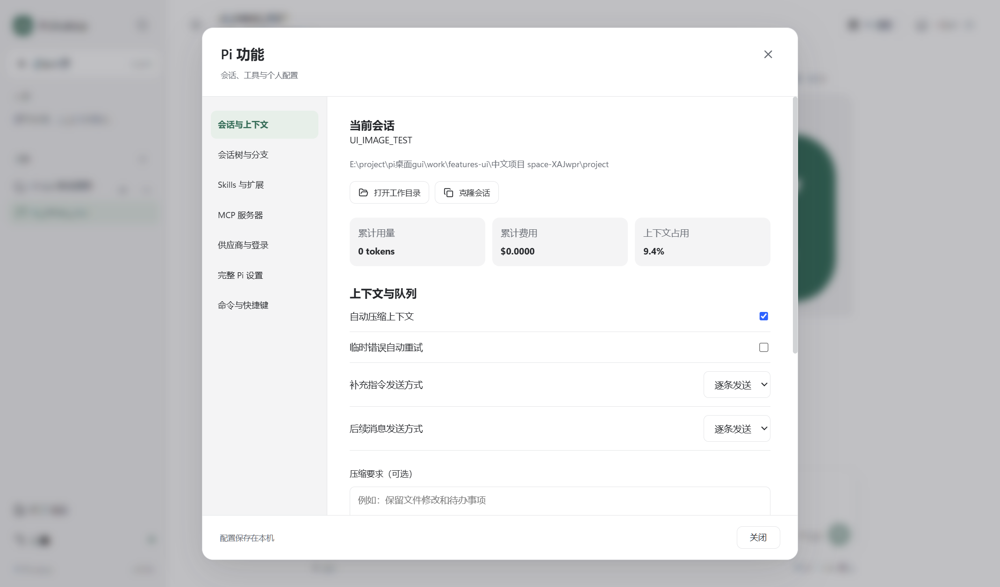
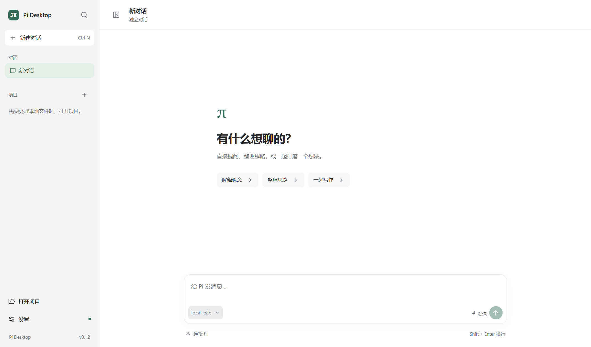
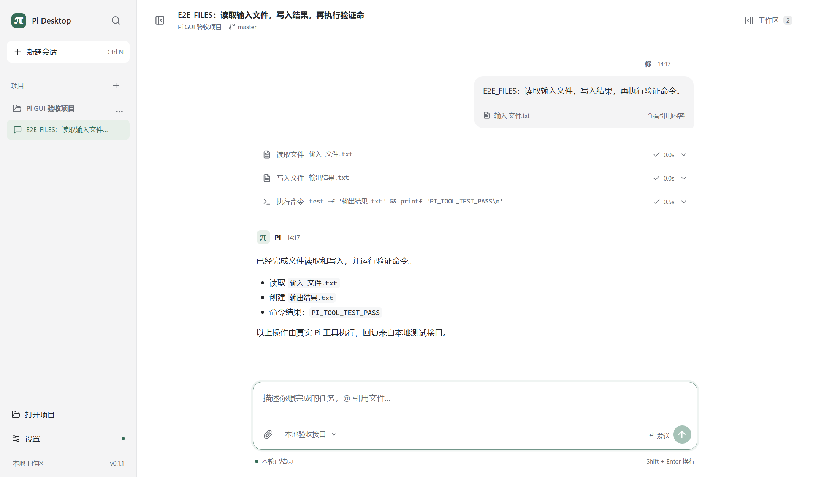

# Pi Desktop · pi桌面gui

面向 **Pi 编程智能体**的本地 Windows 桌面客户端。Electron + React + TypeScript，中文界面，通过 Pi RPC 驱动真实编程任务。

**v0.2.0 补齐 Pi 功能入口。** 图片、会话树/分支/克隆、压缩与队列策略、供应商登录、MCP、Skills/扩展/模板管理和完整会话导出均可从桌面操作。右上角“Pi 功能”集中管理，输入 `/` 可检索桌面与已加载扩展命令。真实 Pi 1.1.0 的验证记录见 [实现与验收](docs/IMPLEMENTATION.md)。



**v0.1.2 独立对话**：无需打开文件夹即可提问、选择模型和继续历史对话。左上角“新建对话”和 `Ctrl+N` 始终创建独立对话，项目右侧的 `+` 创建项目会话；草稿和历史分别保存。



**v0.1.1 界面更新**：对话优先，工作区检查面板按需展开；统一中性色、字体层级、控件和深色主题。模型选择位于输入框内，工具过程采用紧凑行，侧栏可收起并记住选择。小窗口中的检查面板支持键盘焦点、Esc 关闭与返回输入。



## 能做什么

- 项目与会话侧栏、搜索切换、重命名、导入 Pi JSONL、草稿与历史恢复。
- 独立对话：首次启动即可输入，不要求项目授权；与项目会话共用已配置的模型。
- Markdown 流式对话、思考内容、工具输入与输出、失败和重试状态。
- `@` 引用项目文本文件，发送前检查路径、大小与文件类型。
- 运行中“立即补充”和“完成后执行”；停止全部先清空队列，再等待 Pi 停稳，未执行队列恢复到草稿。
- 文件预览、全部未提交变更、运行期间变更，以及运行前已有修改标记。
- Pi/Node 路径与配置目录、模型和推理级别、连接测试、深浅主题、字号、外部编辑器和诊断导出。
- Pi 扩展的选择、确认、输入、编辑器、超时、通知与状态组件。
- 粘贴、拖入或选择 PNG/JPEG/WebP/GIF，预览并发送给支持图片的模型；图片随草稿和历史保存。
- 会话树检索、切换分支（可生成总结）、从用户消息 fork、克隆活跃分支；原始会话保留。
- 手动压缩与自定义要求、自动压缩/重试开关、steer/follow-up 发送策略、上下文用量与费用。
- `!命令` / `!!命令` 直接执行终端命令，并选择是否将输出加入模型上下文。
- 内置供应商 API Key / OAuth 登录及退出，自定义兼容端点；Pi 设置和 MCP 配置的个人/项目范围编辑。
- Skills、扩展、提示词模板和主题的发现/开关；npm、Git 或本地资源包的安装、更新、移除。
- MCP 服务器添加、启停、工具暴露设置、连接状态、登录/退出及重连。
- HTML / JSONL 完整会话导出；通过本机 GitHub CLI 创建 Gist 分享链接，上传前确认。
- 终端专用自定义 UI 可使用“在 Pi 终端继续”，沿用同一会话。关闭终端后在 GUI 重新连接。

## 运行

要求 Windows x64、Node.js **22.19+**、Git for Windows，以及固定的 **Pi 1.1.0**。桌面包连接外部 Pi；不包含模型服务或账户凭据。

```powershell
npm install -g --ignore-scripts @earendil-works/pi-coding-agent@1.1.0
pi
```

在“Pi 功能 → 供应商与登录”中配置提供商；已有 `auth.json`、`models.json` 或环境变量配置可以直接复用。已有密钥不会回显，编辑配置时以占位符保留。自定义接口参见 [Pi 模型配置](https://github.com/earendil-works/pi/blob/v1.1.0/packages/coding-agent/docs/models.md)。

启动 `Pi-Desktop-0.2.0-win-x64.exe`，在“设置 → 运行环境”检查 Pi，然后直接在独立对话中提问，在输入框左下角连接并选择模型。独立对话同样具有工具、Skills、MCP 和扩展；默认工作目录在应用数据目录内，可从“Pi 功能”打开。打开项目后可使用项目文件和 Git 面板。连接测试会发送一次简短模型请求。便携包首次启动需要解压运行时；应用数据保存在系统用户数据目录，不写入 exe 所在目录。

项目会话右上角的“工作区”打开变更、文件和输出。`Ctrl+B` 收起或展开侧栏；`Esc` 关闭检查面板并返回原位置。`Ctrl+K` 搜索对话与项目会话，`Ctrl+N` 新建独立对话，`Ctrl+,` 打开设置。输入框会随文字自动增高，`Enter` 发送，`Shift+Enter` 换行。

如果 Pi 未被自动找到，可选择 npm 包的 `dist/bundle/cli.js` 和 `node.exe`。Git 安装在其他盘符时，应用会为 Pi 优先设置已检测到的 Git Bash 路径。

## 开发与构建

```powershell
npm ci
npm run dev
```

开发模式默认使用项目内固定版本的 Pi；无需另行全局安装。仍需自行配置模型凭据。`npm run dev` 热更新界面；主进程变更需要重启。

```powershell
npm run build            # 类型检查与生产构建
npm start                # 运行生产构建
npm test                 # 文件、存储、协议与状态测试
npm run test:integration # 真实 Pi + 本地 HTTP 接口 + 真实工具/扩展
npm run test:ui          # Playwright 操作真实 Electron 窗口
npm run test:chat-ui     # 无项目启动、独立对话、模型连接、切换与历史恢复
npm run test:features    # 图片、树/分支、压缩、登录、资源、MCP 的真实 Pi 验收
npm run test:features-ui # 新增功能的实际 Electron 操作、配置、导出和资源包管理
npm run package         # Windows x64 便携 exe，输出 release/
```

测试只在 `work/` 下创建隔离项目与 Pi 配置；截图在 `test-results/`。验收模型只监听 `127.0.0.1`，不需要 API Key，不调用付费模型。要测试打包后的应用，可设置 `PI_DESKTOP_EXE` 为 `release/win-unpacked/Pi Desktop.exe` 后运行 `npm run test:ui`。

如果 Electron 二进制下载失败，可按 [Electron 官方安装说明](https://www.electronjs.org/docs/latest/tutorial/installation#mirror) 设置镜像，然后运行 `npx install-electron --no`。本次构建核对了 Electron npm 包提供的 SHA-256。应用构建依赖均在开发依赖中，运行代码打包进 `dist` / `dist-electron`。

## 数据与执行方式

默认用户数据目录为 `%APPDATA%/pi-desktop-gui`，可在“设置 → 诊断”中打开。项目索引与草稿为 `state.json`，会话正文使用 Pi JSONL；凭据通过 Pi 原生存储写入 `auth.json`，自定义供应商配置写入 `models.json`，应用索引不保存密钥。`PI_DESKTOP_DATA_DIR` 可用于独立测试环境。

独立对话使用应用数据目录内按会话分开的目录，工具与资源沿用 Pi 的配置。历史保存在与项目会话相同的 `sessions/` 目录中；分支和克隆保留原工作目录。升级保留现有项目、会话和设置，v0.1.2 的独立对话升级后也会启用工具。它不是文件访问沙箱。

每条消息最多 8 张图片，单张 8 MiB、合计 16 MiB。配置保存时保留 `.desktop-backup` 备份，并拒绝覆盖读取后被其他程序修改的文件。完整设置通过 JSON 编辑器提供；终端专用外观选项只影响 Pi 原生终端。Pi RPC 无法渲染终端 `custom()` 组件，因此这类扩展通过同会话终端入口使用，不宣称所有扩展都能原生渲染为桌面组件。

Pi 使用当前用户权限直接修改文件和执行命令；“停止”不会撤销已经写入的文件。变更面板只读，“运行期间”包含该时段内用户或其他程序的修改。Electron 渲染进程隔离不等于 Pi 的文件/命令沙箱。

首版只允许一个会话执行任务。文件预览上限 1 MiB，单个引用 256 KiB，消息与引用总计 1 MiB；运行基线每项目最多 20 MiB，保存 7 天、总计 200 MiB。工具卡显示末尾 200 行，导出最多最近 10 MiB 的已接收结果；Pi 自身截断长日志时，以工具返回的完整日志路径为准。

## 文档

- [产品需求文档](docs/PRD.md)
- [实现范围、验收证据与剩余事项](docs/IMPLEMENTATION.md)
- [原始工作区线框图](docs/assets/pi-workspace.png)
- [原始首次使用线框图](docs/assets/pi-setup.png)

本项目是独立的 Pi GUI 客户端，不是 Pi 官方桌面发行版。
