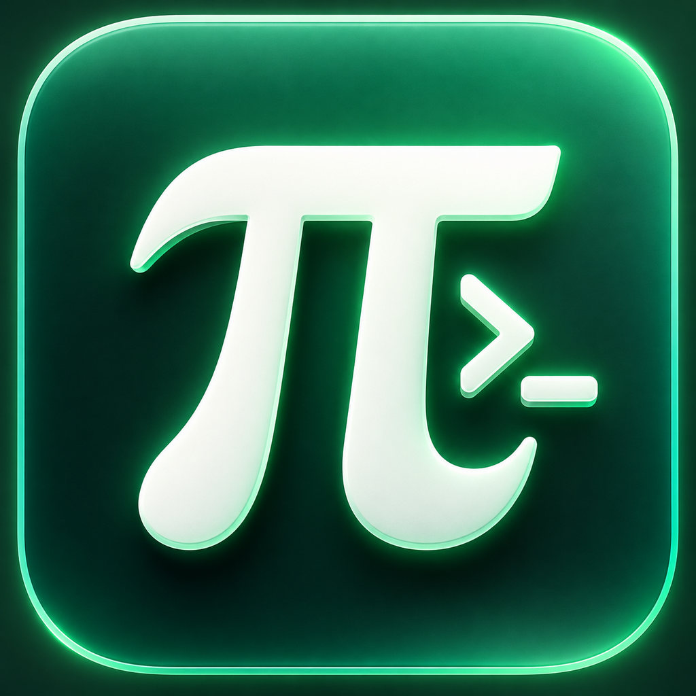
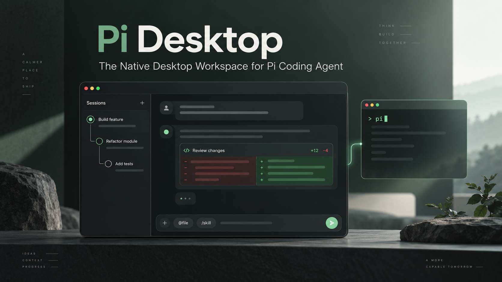
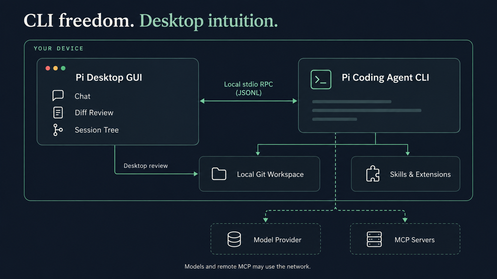
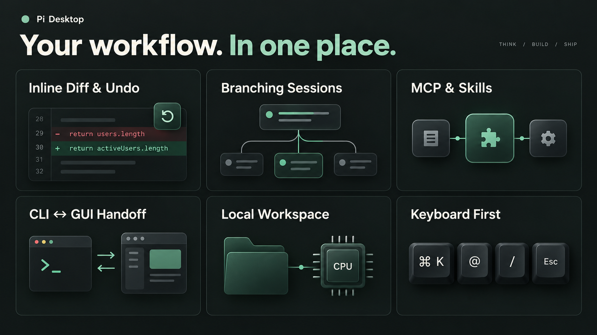

<div align="center">



# Pi Desktop

**为开发者打造的本地 AI 编程工作台 —— 终端的自由，桌面的直觉。**<br />
*The Native Desktop Workspace for the Pi Coding Agent.*

[](https://github.com/yeyuProject/pi-desktop-gui/releases)
[](#-快速开始)
[](https://www.electronjs.org/)
[](https://react.dev/)
[](https://www.typescriptlang.org/)

[设计理念](#-设计理念) · [核心特性](#-核心特性) · [快速开始](#-快速开始) · [快捷键与指令](#-快捷键与指令) · [参与开发](#-参与开发)

<br />



<p><sub>AI 生成品牌概念图</sub></p>

</div>

---

## 💡 设计理念

命令行编程智能体（CLI Coding Agent）拥有极高的执行效率与可组合性，但在面对**大段代码 Diff 审查、多分支思路探索、多模态图表输入、以及 MCP / Skills 生态配置**时，纯终端界面往往显得局促。

**Pi Desktop** 为此而生：

- **桌面与智能体在本机通信**：通过本地 `stdio` 上的 Pi RPC（按行传输 JSON，即 JSONL）驱动你机器上的 `pi`，桌面与智能体之间无需额外中转服务。
- **终端与 GUI 共用会话**：复用 Pi 会话历史、模型凭据与扩展配置。通过「在 Pi 终端继续」交接同一会话；关闭终端后回到桌面重新连接，也可从桌面打开终端创建的历史会话。
- **对话优先，审查随行**：保持简洁的对话流；当智能体修改代码时，按需展开工作区变更与内联 Diff，并可撤销纳入运行基线的文件修改。



会话与工作区保存在本机；模型请求沿用 Pi 的供应商配置，远程 MCP 也可能联网。「本地工作台」不代表所有推理都在本机完成。

---

## ✨ 核心特性



<table>
  <tr>
    <td width="50%" valign="top">
      <h3>🧠 可视化智能体工作流</h3>
      <p>实时呈现模型返回的思考内容（Thinking）、工具调用参数与命令退出状态。代码修改直接在对话流内联渲染 Diff，底部显示上下文用量、Token 消耗与费用。</p>
    </td>
    <td width="50%" valign="top">
      <h3>🌿 像 Git 一样分支对话</h3>
      <p>从历史用户消息编辑重发或 Fork 独立分支，切换分支时可生成总结，也可克隆活跃分支，围绕同一问题探索多种实现方案。</p>
    </td>
  </tr>
  <tr>
    <td width="50%" valign="top">
      <h3>⏪ 代码快照与文件撤销</h3>
      <p>在 Git 项目中，任务开始前为受支持文件建立基线。支持<strong>撤销本轮文件修改</strong>或<strong>单独回滚指定文件</strong>；撤销本轮新建文件时移入回收站。未纳入基线的文件会明确提示，命令产生的外部副作用不在文件撤销范围内。</p>
    </td>
    <td width="50%" valign="top">
      <h3>🔌 全栈生态控制中心</h3>
      <p>告别手写繁琐的配置文件。图形化管理多模型供应商（API Key / OAuth）、MCP 服务器工具暴露、Skills 技能包、扩展插件与提示词模板。</p>
    </td>
  </tr>
  <tr>
    <td width="50%" valign="top">
      <h3>⚡ 随手提问 vs 深度工程</h3>
      <p>启动即可开启<strong>独立对话</strong>，无需绑定代码仓库也能使用全套工具与联网扩展；进入<strong>项目会话</strong>则自动挂载文件树、Git 状态对比与工作区快照。</p>
    </td>
    <td width="50%" valign="top">
      <h3>🖥️ 终端与桌面交接</h3>
      <p>支持在运行途中补充要求（Steer）或追加后续队列（Follow-up）。需要终端专用扩展界面时，点击<strong>「在 Pi 终端继续」</strong>沿用同一会话；关闭终端后可回到桌面重新连接。</p>
    </td>
  </tr>
</table>

---

## 🚀 快速开始

### 1. 安装底层智能体引擎

Pi Desktop 依赖本机 Node.js（`>= 22.19`）与 Pi Coding Agent CLI：

```bash
npm install -g --ignore-scripts @earendil-works/pi-coding-agent@1.1.0
```

> **Windows 用户提示**：请确保已安装 [Git for Windows](https://git-scm.com/download/win)（提供智能体执行命令所需的 Git Bash 环境）。

### 2. 下载桌面客户端

前往 [最新版本下载](https://github.com/yeyuProject/pi-desktop-gui/releases/latest) 下载对应系统的安装包。每个版本同时提供 `SHA256SUMS.txt`，用于核对下载文件：

| 平台 | 支持架构 | 分发格式 |
| :--- | :--- | :--- |
| **Windows** | `x64` | `.exe` 便携版（双击即用，无需安装） |
| **macOS** | `Apple Silicon (M系列)` / `Intel` | `.dmg` 磁盘映像 / `.zip` |
| **Linux** | `x86_64` | `.AppImage` / `.deb` |

<details>
<summary><b>macOS 首次打开提示「无法验证开发者」或「已损坏」？</b></summary>

应用目前尚未注入 Apple Developer 签名，首次打开请按住 `Control` 键点击应用图标并选择「打开」，或在终端运行以下命令解除隔离属性：

```bash
xattr -dr com.apple.quarantine "/Applications/Pi Desktop.app"
```
</details>

### 3. 连接模型并开始编程

1. 启动 **Pi Desktop**，应用会自动扫描系统及 `nvm` / `Homebrew` 路径下的 `pi` 运行时。
2. 点击右上角 **「Pi 功能 → 供应商与登录」**，配置你的模型服务商（支持 OAuth 登录、API Key 或任意 OpenAI 兼容接口；若终端已配置过 `~/.pi` 将自动识别）。
3. 在左下角选择模型与推理深度，即可开始对话或打开本地项目文件夹。

---

## ⌨️ 快捷键与指令

### 输入框指令语法

在输入框中通过前缀字符即可快速调用上下文与工具：

| 指令前缀 | 作用 | 用法示例 |
| :---: | :--- | :--- |
| **`@`** | 引用项目文件（也支持直接将文件或图片拖入输入框） | `@src/App.tsx 优化这里的渲染性能` |
| **`/`** | 唤起斜杠菜单，检索并调用 Skills、提示词模板与扩展命令 | `/commit` |
| **`//`** | 绕过桌面同名快捷键，直接调用底层 Pi 原生斜杠命令 | `//compact` |
| **`!`** | 直接在当前工作目录执行 Shell 命令，并将输出注入对话上下文 | `!npm test` |
| **`!!`** | 直接执行 Shell 命令，仅在本地查看结果，**不消耗**模型上下文 | `!!git status` |

### 常用全局快捷键

| 功能 | Windows / Linux | macOS |
| :--- | :---: | :---: |
| 新建独立对话 | `Ctrl + N` | `⌘ + N` |
| 全局搜索会话与历史消息 | `Ctrl + K` | `⌘ + K` |
| 展开 / 收起左侧边栏 | `Ctrl + B` | `⌘ + B` |
| 打开设置中心 | `Ctrl + ,` | `⌘ + ,` |
| 查看快捷键速查面板 | `Ctrl + /` | `⌘ + /` |
| 翻阅当前会话发送历史（空输入框时） | `↑` / `↓` | `↑` / `↓` |
| 关闭右侧检查面板并聚焦输入框 | `Esc` | `Esc` |
| **紧急熔断**：停止全部正在执行的任务 | `连按两次 Esc` | `连按两次 Esc` |

---

## 🛠️ 参与开发

### 项目结构

```text
pi-desktop/
├── electron/           # Electron 主进程与系统桥接层
│   ├── main.ts         # 窗口生命周期、菜单与 IPC 路由
│   ├── rpc.ts          # Pi Agent stdio RPC 通信（JSONL）
│   ├── workspace.ts    # 工作区文件监控、Git Diff 与快照回滚
│   ├── history.ts      # JSONL 会话树解析与全文检索
│   └── ...
├── src/                # React 19 渲染进程前端
│   ├── App.tsx         # 主工作台、对话流与消息分支交互
│   ├── PiFeatures.tsx  # MCP / Skills / 供应商 / 会话树管理中心
│   └── SettingsForm.tsx# 环境诊断与偏好设置
├── shared/             # 主进程与渲染进程共享类型契约
└── scripts/            # 构建、打包与端到端自动化验收脚本
```

### 本地启动与构建

开发环境已内置锁定版本的 Pi 依赖，克隆仓库后即可直接运行：

```bash
# 克隆仓库
git clone https://github.com/yeyuProject/pi-desktop-gui.git
cd pi-desktop-gui

# 安装依赖
npm ci

# 启动热更新开发环境
npm run dev
```

其他常用工程命令：

```bash
npm run build            # TypeScript 类型检查 + 生产环境构建
npm test                 # 运行核心单元测试
npm run test:integration # 运行 Pi RPC 与工具链集成测试
npm run test:ui          # 运行 Playwright + Electron 端到端桌面交互测试
npm run icons            # 从 1024 × 1024 原图重新导出各平台图标（在桌面环境执行）
npm run package          # 打包当前操作系统的发行安装包 (输出至 release/)
```

应用图标原图为 `build/icon-source-v2.png`，生成提示词保存在同目录的 `.prompt.txt` 文件中。运行 `npm run icons` 后一并提交 `icon.png`、`icon-mac.png`、`icon.ico`；CI 直接使用这些文件打包。

### GitHub 自动构建与发布

普通提交和 Pull Request 会在 Windows、macOS、Linux 上构建并执行测试。在 Actions 中手动运行 **Build, test and release**，测试通过后可以从该次运行的 Artifacts 下载安装包。

正式发布时，更新 `package.json` 的版本号与锁文件，补充 `docs/releases/v<版本>.md` 发布说明，再推送对应的 `v<版本>` 标签。三平台测试和打包全部成功后，工作流会创建 GitHub Release，上传安装包和 SHA-256 校验文件。标签版本必须与包版本一致；应用界面中的版本号从包版本自动生成。

---

## 📄 开源说明与致谢

- 核心智能体引擎基于 [@earendil-works/pi-coding-agent](https://www.npmjs.com/package/@earendil-works/pi-coding-agent) 构建。
- 本项目为社区驱动的独立桌面客户端，非官方发行版本。欢迎提交 Issue 与 Pull Request！
- README 插图与生成提示词见 [视觉素材说明](docs/assets/README.md)。
