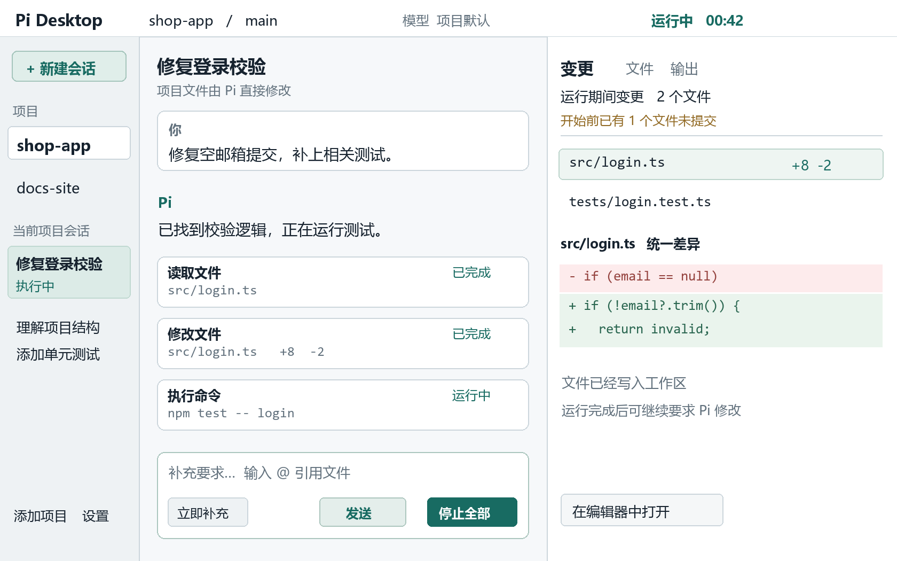
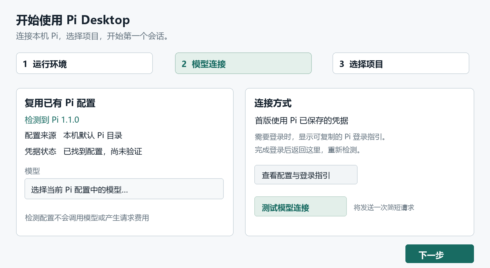

# Pi 桌面 GUI 产品需求文档

首版功能 页面与交互设计

## v0.8.0：稳定性与模块化（已实现）

本次实现范围为 R1、R2、R3。后续按 v0.9.0 → v0.10.0 → v0.11.0 推进，各版单独实现和验收。本版模块边界见 [架构说明](architecture.md)，验收证据见 [v0.8.0 验收记录](v0.8-validation.md)。

产品取舍原则：桌面端只做图形界面明显优于终端的事情（查看差异与撤销、审批、图片、通知、会话管理、稳定性）。Pi 已有的配置与管理能力复用其公开接口，不修改 Pi 本身。

### R1 本地索引与进程中断恢复

- 本地索引最多保留三份备份，相邻备份至少间隔十分钟。索引损坏时保留原文件，按顺序恢复可用备份；当前索引缺失时同样尝试恢复。无法恢复时以空索引启动，Pi JSONL 文件保持原样。
- 项目、会话与设置逐项校验，坏记录不影响其余记录。顶部提示明确显示备份时间、丢弃数量或重置设置数量，可以打开数据目录和关闭提示。
- 数据目录不能写入时进入只读状态，停止新任务及保存；任务发送前等待持久化结果，避免保存失败后仍调用模型。
- 意外退出卡片提供退出码、信号、最后工具及运行时间、最后二十行日志、本轮变更入口，以及重连、编辑提问后继续和撤销入口。十秒内重复崩溃有单独提示。
- 尚未执行的 steering/follow-up 文字与图片恢复到草稿，不自动重发；用户主动停止和终端交接不显示崩溃卡片。
- **明确边界：** Pi 主进程退出后，外部命令可能仍在运行。只有没有运行工具、或应用已成功结束整棵进程树时，才允许直接恢复。无法确认时后端与界面阻止启动、切换和撤销，用户需先手动结束残留命令，再重启应用；仅刷新窗口不会解除限制，仅重启应用不会结束旧命令。
- 覆盖：`tests/store.test.ts`、`scripts/test-recovery.ts`、`scripts/test-recovery-ui.mjs`，包括真实 Pi 崩溃、队列图片、磁盘写失败、停止竞争与只结束主进程的场景。

### R2 界面模块拆分与 CI

- `App.tsx` 只组合布局；面板、弹窗及消息展示进入 `components/`，状态订阅、草稿和快捷键进入 `hooks/`，纯展示函数进入 `lib/`。
- `PiFeatures.tsx` 按页签拆到 `features/`；样式按原顺序拆分，保留组件缓存、引用稳定性和增量推送。
- `App.tsx` 为 73 行，`src/` 最大文件为 676 行，均满足本版限制。
- Linux CI 通过 Xvfb 运行三套界面测试，失败时上传截图。Windows 本地界面测试已通过；macOS 界面未在本机实测，三平台的后端与构建结果以验收记录为准。
- 500 条消息、100 个工具、60 次更新：纯拆分前后中位耗时 14.9 → 14.8 ms，最终功能版本为 15.0 ms。纯拆分截图差异 3 / 1,189,040 像素（0.0002523%），低于 0.1% 阈值。

### R3 Pi 补丁兼容与协议边界

- 版本策略集中在 `shared/pi-version.ts`，由 `environment.ts` 导出供主进程使用。已验证版本为 1.1.0，允许 1.1.x 补丁与同线预发布版本；其他版本线和无法识别的版本明确拒绝。
- 设置和开始前检查显示“已验证 / 兼容 / 过旧 / 过新 / 未知”。不支持时禁用发送并提供可复制的 `@1.1` 安装命令；模型测试、资源包操作和终端启动同样检查版本。
- `electron/pi/protocol.ts` 校验核心响应并转换统计字段；桌面扩展调用先确认命令注册，再核对协议版本。不会猜测新旧字段别名，也不会把缺失的内部扩展命令发送给模型。
- 诊断包含 `piCompatibility`。每周工作流安装最新 1.1 补丁，运行单元、集成与功能测试；开发依赖仍锁定完整回归基准。
- 覆盖：版本分类、数字比较、假入口 1.1.1 / 1.2.0、协议格式错误、扩展缺失、探测入口限制和两处界面提示；真实 Pi 仍使用本地模型服务回归。

### 执行约定

交给其他同学执行时，请遵守以下约定，避免和现有实现冲突：

- **平台差异**统一放在 `electron/platform.ts`，不要在业务代码里写 `process.platform` 分支。路径比较用 `samePath()` / `pathKey()`。
- **与 Pi 交互**优先用 RPC 命令；RPC 没有的能力（树导航、标签、审批等）放进桌面适配扩展 `electron/pi-bridge.ts`，通过 `rpc.bridge(method, params)` 调用。不要修改 Pi 本身。
- **主进程到界面的状态**走增量推送（`runtimePatch`，见 `shared/types.ts` 的 `applyRuntimePatch`）。新增运行时字段时放在标量部分即可；新增数组必须同时更新 `flush()` 的增量逻辑和 `tests/runtime-patch.test.ts`。
- **新 IPC 方法**要在 `shared/types.ts` 的 `ApiMap` 声明，在 `electron/main.ts` 的 `handlers` 中校验所有参数（`text()` / `strings()`）；会启动或切换 Pi 的方法加入 `engineOperation` 列表。
- **文案**为中文，按钮写明动作结果（“撤销修改”而不是“确定”），错误说明原因和处理办法。
- **测试**：纯逻辑写进 `tests/*.test.ts`（`npm test`）；涉及 Pi 行为的用真实 Pi + 本地测试接口写进 `scripts/test-*.ts` 并加入 `npm run test:features`；界面行为加到对应的 `scripts/test-*-ui.mjs`。测试不得访问外网或调用付费模型。
- **文件换行**：仓库文件多为 CRLF，编辑时保持原换行，提交前运行 `npm run format`。
- **完成标准**：`npm run build`、`npm test`、`npm run test:integration`、`npm run test:features` 全部通过；涉及界面的同时通过对应 UI 测试；完成后把该项从“下一版”移入对应版本小节，写明实际范围；未做完的部分直接删除，不保留为待办。

## v0.9.0：应用内更新（已实现）

本版完成 U1，基于 v0.8.0 的索引备份和恢复能力。旧版用户需要手动安装 v0.9.0 一次，后续才可使用应用内更新。模块边界见 [架构说明](architecture.md)，验证证据见 [v0.9.0 验收记录](v0.9-validation.md)。

### U1 检查、下载与安装更新

| 安装方式 | 实际能力 |
| --- | --- |
| Windows NSIS 安装版 | 按用户安装，无需管理员权限；后台下载、重启安装和正常退出时安装，原生更新器支持差量下载 |
| Linux AppImage | 后台下载、重启安装和正常退出时安装 |
| Windows 便携版 | 检查与提示，打开对应 Release 页面，提示可改用安装版 |
| macOS / Linux deb | 检查与提示，打开对应 Release 页面手动下载安装 |

- 启动 10 秒后检查，此后每 6 小时检查，手动检查立即发起。检查时点由客户端决定，不承诺在 GitHub 发版后 60 秒内主动推送。
- 支持自动更新的安装方式默认后台下载，设置可关闭；下载过程不中断任务。侧栏显示下载进度或“重启以更新”，点击查看 GitHub Release 的 Markdown 说明。
- 立即重启前检查任务、审批、配置修改及已经受理但尚未切换运行状态的操作。存在这些操作时拒绝安装；准备安装后阻止新操作，先保存最新草稿并等待写盘，断开空闲 Pi，再启动安装器。
- 选择“稍后”后，下次正常退出时安装；任务仍在执行时沿用停止确认。系统关机、数据保存失败或无法确认旧命令已停止时不自动安装。
- “设置 → 关于与更新”显示当前版本、安装方式、上次检查时间、检查按钮、自动下载开关、本版说明和新版本说明。离线或校验失败不弹窗，错误和重试入口留在该页，提供手动下载链接。
- 开发模式和设置了 `PI_DESKTOP_DATA_DIR` 的测试模式不请求更新服务。更新状态通过独立 `update` 事件传给界面，不混入 Pi 运行状态。

### 数据与发布

- Windows 安装版和便携版的 `appId`、`productName`、默认数据目录保持一致；切换安装方式沿用原有会话、草稿、设置和审批模式。
- `state.json` 记录最后写入的 `appVersion`。升级首次启动前保存原始 `state.pre-<旧版本>.json`，最多三份；旧文件没有版本信息时使用 `state.pre-unversioned.json`，不猜测来源版本。备份失败则只读打开。
- 降级时，如果仍认识索引格式，可以正常使用；不认识较新格式则只读打开并提示所需版本，不重命名、不覆盖原文件。只读查看也不会尝试保存滚动位置。
- `electron-updater` 由 esbuild 打包进主进程，保留现有文件白名单。更新策略、原生更新器适配、共享状态与界面分别放在独立模块。
- CI 上传安装包、`latest.yml`、`latest-linux.yml` 和 Windows 安装包的 `.blockmap`；发布前验证清单版本、目标文件、大小与 SHA-512，SHA-256 清单覆盖全部发布文件。本地打包保持 `publish: never`。
- `scripts/test-update.ts` 在 Windows/Linux 使用两个真实安装包与回环 HTTP 服务验证校验失败、重试、任务阻止安装、重启安装、退出安装和数据保留；Windows 另验证便携版切换安装版。测试使用独立应用标识、安装目录及数据，并阻断应用的非本地 HTTP 请求。
- 单元测试覆盖安装方式、稳定版比较、检查间隔、重复请求、安装竞争、备份失败、备份轮转、降级保护和发布清单；界面测试覆盖三类提示模式、进度、失败、设置持久化、审批限制和只读提示。

### 明确边界

不提供 beta 通道、强制更新或应用内回滚。Windows 安装包目前未签名，下载完整性依靠更新清单中的 SHA-512；发布账号仍需妥善保护。macOS 在完成签名前保持手动安装。应用更新不负责安装或升级 Pi CLI。

## v0.10.0：切换会话不再等待，模型错误看得懂（已实现）

本版完成 S1、S2，基于 v0.9.0。验收记录见 [v0.10.0 验收记录](v0.10-validation.md)，后续版本继续独立开发和验收。

### S1 切换会话复用 Pi 进程

**背景与结果。** 原流程调用原生切换后仍关闭并重新启动 Pi。本版把进程监听、会话绑定和启动分开：同一工作目录内复用原进程，切换后重新绑定目标历史、工具输出、模型、推理级别、审批模式、标题与命令列表。

| 情况 | 实际行为 |
| --- | --- |
| 当前进程正常，目标已有会话文件，且工作目录相同 | 原生 `switch_session`，保持 Pi 进程号 |
| 当前进程正常，目标是新会话，且工作目录相同 | 原生 `new_session`，保持 Pi 进程号 |
| 工作目录不同，包括已有会话 | 重新启动 Pi，重新加载项目环境 |
| 没有进程、进程退出、从 Pi 终端返回或运行环境配置改变 | 重新启动 |
| 复用切换失败，或适配扩展未确认目标会话开始 | 重新启动恢复，并记录原因；恢复成功不显示错误条 |
| 扩展明确取消切换 | 保持原会话并提示取消，不重启 |

- `rebindSession()` 统一初始化目标状态，清理旧对话框、队列图片、通知、停止标记和工具输出；历史与能力读取合并，避免重复获取模型列表和完整消息。
- 桌面扩展在 `session_start` 清空“总是允许”，并发出明确的会话开始事件。旧会话退出钩子的编辑操作仍属于旧草稿，新会话启动事件归入目标会话；切换确认框保持可回答。
- 旧的异步刷新不能覆盖目标会话。切换期间不能断开或修改运行环境，避免关闭旧进程后又被恢复流程重新启动。
- 诊断包含最近一次切换方式、后端耗时、重启原因与 Pi 进程号。界面验收单独测量实际点击至目标消息显示，不能用后端耗时代替。

**跨目录验证结论。** 真实 Pi 1.1.0 的原生跨目录切换会改变会话上下文，但 Node 进程的 `process.cwd()` 仍是项目 A；项目 B 扩展按该值注册的命令与冷启动 B 不一致。测试同时验证项目设置和“不信任项目资源”策略。因此按本版约定，跨目录统一重新启动，不修改 Pi 或猜测扩展兼容行为。

**回归。** `test-workflow.ts` 覆盖十次复用、模型与推理级别、旧草稿与目标事件、扩展确认/取消、断开竞争、切换失败恢复和进程退出后的首次切换；`test-session-context.ts` 固定跨目录对比；`test-approval.ts` 验证切走和切回都不继承“总是允许”。`test-session-ui.mjs --packaged` 在 Windows/macOS 发布构建中实际点击十次，要求每次不超过 200 毫秒且进程号不变，结果上传 CI 产物。

### S2 模型请求错误分类与处理入口

错误卡片替换模型请求失败时的原始红色错误条，显示中文原因、处理入口、复制详细信息和可展开的脱敏原文。未知错误直接展开原文，不猜测原因；Pi 安装、进程、存储等错误沿用原有提示。

| 类别 | 主操作 |
| --- | --- |
| 凭据无效或无访问权限 | 管理供应商与登录 |
| 额度不足或欠费 | 显示去当前供应商网站查看余额与账单的说明 |
| 请求过多或服务繁忙 | 重新生成当前失败回复 |
| 上下文过长 | 压缩上下文；未开启自动压缩时提供开启入口 |
| 模型不存在或无权使用 | 打开模型选择面板 |
| 网络或代理错误 | 打开常用设置中的 HTTP 代理 |
| 未识别错误 | 显示并允许复制原文 |

- `shared/errors.ts` 集中分类、说明和脱敏。匹配优先级为凭据、额度、限流、上下文、模型、网络；通用 503 只在没有具体原因时归为繁忙。真实 Pi SDK 的 `Connection error.` 同样归为网络错误。
- 同一会话同类请求连续失败三次起显示失败次数；成功请求清零。Pi 自带重试结束与任务结束不会重复计数；应用不会额外自动重试或切换模型。
- `runtime.errorKind/errorCount` 通过原有增量状态传递；`ModelErrorCard` 独立处理展示，操作复用现有供应商、重新生成、压缩、模型选择与代理设置入口。
- 界面、复制、诊断及重新读取的历史错误文本经过脱敏；不修改 Pi 自己保存的原始 JSONL。诊断额外记录最近五次错误的类别与时间，不在该列表保留原文。
- 单元测试包含 45 条供应商/SDK 格式样本。`test-model-errors.ts` 用真实 Pi 和本地 HTTP 服务验证 401、429、额度、上下文、模型错误、连续计数、成功清零与真实连接拒绝；`test-model-errors-ui.mjs` 验证操作入口、脱敏和界面布局。所有模型请求均使用隔离的本地测试服务。

## v0.11.0：按轮次撤销文件修改（规划）

v0.10.0 之后开始。约 4 人日。

### T1 每轮检查点，可撤销到任意一轮之前

**背景与问题。** 运行快照按项目只保留最近一次（`electron/workspace.ts` 以 `${project.id}.json` 存一份基线，每次发送都会覆盖）。用户发出第二条消息后，第一轮的修改就无法再一键撤销；而实际使用中，往往要过两三轮才发现方向错了。v0.7.0 的 Git 快照让单次快照足够快（1 万文件约 0.4 秒），且内容相同的文件不重复存储，具备保留多轮的条件。

**目标。** 在一个会话中，可以把项目文件恢复到任意一轮开始之前的状态。

**不做。** 不撤销命令产生的外部副作用（数据库、网络请求、已安装的依赖等），界面需明确说明；不提供跨会话的检查点；非 Git 项目仍不支持撤销。

**交互。**

- 每条用户消息的悬停操作中，新增“撤销此轮起的文件修改”（仅项目会话、且该轮有检查点时显示）。
- 点击后先展示将被恢复的文件清单（新增 / 修改 / 删除），并单独标出“该轮之后你手动改过的文件”（检查点之后被修改，但不在 Pi 的工具调用记录中的文件），用户可取消勾选这些文件；确认后执行。
- 撤销完成后提示“已把 N 个文件恢复到第 3 轮之前”，并提供“同时回到这条消息之前的对话”按钮（复用现有“编辑后重新发送”的会话树导航，不自动执行）。
- 工作区“运行期间变更”的下拉框增加“自第 N 轮起”的选项，用于查看跨多轮的累计变更；原“本轮”保持默认。

**技术方案。**

- 存储：基线从“每项目一份”改为“每会话多份”，文件名 `${sessionId}-${turn}.json`，`turn` 为该轮用户消息在会话中的序号，同时记录该消息的时间戳以便界面定位。快照仓库沿用私有 Git 仓库，同一会话的多轮共用一个仓库，以免重复存储。
- 保留策略：每个会话最多 20 轮；全部快照总量上限仍为 200 MiB、保留 7 天；超过时先删除最旧会话的最旧检查点。
- 失效规则：切换 Git 分支后，该会话之前的检查点全部失效（与现在一致）；**提交不再使检查点失效**——恢复后，已提交的修改会以未提交变更的形式出现，确认清单中需注明“包含已提交的内容”。
- 撤销实现：比较当前文件与目标检查点，复用现有 `revert` 的逐文件恢复逻辑（先读取全部原内容再写入，新建文件移到回收站）。
- “手动改过的文件”：目标检查点之后，Pi 的 `edit` / `write` 工具记录及命令执行期间的变更都属于 Pi；其余变化的文件视为手动修改。无法确定时按手动修改处理，默认不勾选。
- 迁移：升级时现有的每项目基线继续作为“本轮”使用，不转换。

**验收标准。**

1. 连续 3 轮分别修改不同文件后，选择撤销第 1 轮起的修改，三轮的改动全部恢复，第 1 轮之前已有的未提交修改保持不变。
2. 第 2 轮后手动修改一个文件，撤销第 1 轮起的修改时，该文件出现在“手动改过”列表中且默认不勾选；不勾选时该文件保持手动修改后的内容。
3. 第 2 轮后执行一次 `git commit`，撤销第 1 轮起的修改仍可用，确认清单注明“包含已提交的内容”；切换分支后检查点显示为不可用并说明原因。
4. 20 轮之后，第 1 轮的检查点自动清理，对应消息不再显示撤销操作。
5. 单个检查点的建立耗时与 v0.7.0 相当（1 万文件仓库不超过 0.5 秒），20 轮检查点的磁盘占用不超过修改内容本身的 2 倍。

**测试。** `tests/snapshot.test.ts` 增加多轮、手动修改识别、提交后恢复、分支切换失效、保留上限；`scripts/test-coding.ts` 增加真实 Pi 三轮修改后撤销的场景。

## v0.7.0 需求补充：工具审批、Git 快照与长会话性能

以下三项为 v0.7.0 的新增功能。审批使用真实 Pi 1.1.0 和本地测试接口验收（`scripts/test-approval.ts`、`scripts/test-approval-ui.mjs`）；快照与增量状态使用回归测试验证（`tests/core.test.ts`、`tests/snapshot.test.ts`、`tests/runtime-patch.test.ts`）。性能部分尚未完成原方案全部目标。

### 工具审批模式（原 C1）

- 输入框左下角新增审批模式切换：**全自动**（默认，沿用原行为）、**确认修改**、**只读**。模式按会话保存，重连后恢复；执行中切换会在本轮结束后生效。
- 判定由桌面适配扩展在 Pi 的 `tool_call` 和 `user_bash` 钩子中完成：内置读取与搜索工具（read / grep / find / ls / tool_search）放行；“确认修改”下写入、命令和其他工具需要确认；“只读”下直接拒绝这些操作，不弹确认。外部工具自报的 `readOnlyHint` 不作为放行依据。手动 `!` / `!!` 命令也遵守当前模式。
- “只读”限定于经过拦截的工具调用，不能限制扩展自身代码或系统进程，不是操作系统沙箱。扩展仍需要用户信任。
- 确认以卡片形式出现在对话流中（不再是模态框）：命令显示全文，edit 显示改动行，write 显示写入内容。操作为“允许 / 本会话总是允许（命令按完全相同的文本匹配，其他工具按工具名） / 拒绝…（可填写原因）”，拒绝原因作为工具结果交给模型。
- 停止任务会自动拒绝所有待确认项；被拒绝的调用不会开始执行。临时“总是允许”授权在切换 Pi 会话或退出确认模式后清除，重新连接也不会保留。

### 基于 Git 的运行快照（原 C2）

- Git 项目中，每次发送前把工作区文件以 Git 对象形式存入应用数据目录下的私有仓库，该仓库借用项目的对象库，项目已有的内容不重复存储。项目自身的 `.git` 只读，不新增对象、引用、stash 或索引变化。
- 单文件上限从 1 MiB 提高到 50 MiB；纳入快照的二进制内容、原始换行符和 POSIX 读写执行权限可恢复，SHA-1 和 SHA-256 仓库均支持。二进制或超过 1 MiB 的文件可以撤销，但不显示差异预览。
- 范围沿用项目文件扫描：最多 2 万个文件，排除凭据、构建目录及未跟踪的忽略文件。符号链接、非普通文件、超过 50 MiB 或名称包含换行的文件不纳入快照；非 Git 目录不提供本轮撤销。
- 保留最多 7 天，应用快照总量上限 200 MiB（包含私有 Git 对象）。超过容量会清理旧快照；如果新快照本身超过上限，任务不会开始并提示原因。每个项目仅保留最近一次基线。
- 撤销前先检查变化扫描是否成功并读取全部原内容，避免缺失对象后才发现无法恢复；后续磁盘写入失败仍可能留下部分已恢复文件。旧格式快照不能沿用，升级后需要新任务建立基线。借用的 Git 对象若被项目的垃圾回收删除，撤销会明确报错；快照不能替代备份。
- 尚未提供可复现的性能测量脚本，不对 1 万文件仓库的快照耗时作数值承诺。

### 长会话性能（原 C4）

- 主进程不再每次发送整个消息和工具数组，改为从首个变化位置推送后续项；未变化的前缀保留原对象，完全未变化的数组保留原引用。窗口刷新或重连时自动全量同步。
- 消息使用缓存组件，Markdown 只在文本变化时重新解析；工具完成状态也必须刷新，不能复用仍在运行时的旧缓存。
- 未实现可视区域虚拟列表；`App.tsx` 的拆分见下一版 R2。

## v0.6.1 修复与视觉调整

- 纯文字消息不再渲染空图片容器，修正气泡下方多出的段落间距；多段文字与图片消息保留各自间距。
- 调整工具调用之间的连接线、展开状态连线及输入框运行提示。
- 使用新的高清 π 图标，统一窗口与 Windows、macOS、Linux 打包资源；Windows ICO 包含 16 至 256 像素的九种尺寸。

## v0.6.0 需求补充：macOS 与 Linux

- 支持 Windows x64、macOS（x64 / arm64）与 Linux x64。macOS 暂不签名、不公证，README 说明首次打开方式。
- 平台差异集中在 `electron/platform.ts`：路径比较（Windows、macOS 不区分大小写，Linux 区分）、外部终端、外部文本编辑器、编辑器路径校验、登录 shell PATH。
- “在 Pi 终端继续”：Windows 用 PowerShell，macOS 用“终端”，Linux 依次尝试常见终端。锁文件记录实际运行 Pi 的进程（Windows 为等待 Pi 结束的 PowerShell），不使用启动器进程号。启动失败立即释放，启动未确认最多等待 15 秒；运行期间不按时长过期，进程结束后自动清除残留锁。
- 停止任务：POSIX 上 Pi 运行在独立进程组，强制结束会连同 Pi 启动的命令一起结束。
- 运行环境：只有 Windows 要求 Git Bash；macOS / Linux 使用系统 bash。从访达或桌面菜单启动时读取登录 shell 的 PATH。
- macOS 习惯：快捷键使用 ⌘，界面中的快捷键提示随平台显示；提供应用菜单（关于、设置 ⌘,、隐藏、退出）和窗口菜单；隐藏式标题栏，侧栏和顶栏可拖动窗口；关闭窗口不退出，点程序坞图标恢复，⌘Q 退出时仍提示正在执行的任务。“回收站 / 资源管理器”等文案按平台显示为“废纸篓 / 访达 / 文件管理器”。
- 打包：`npm run package` 生成当前系统的安装包；CI 在 Windows、macOS、Ubuntu 上分别构建并运行单元测试与真实 Pi 测试，推送 `v*` 标签时上传三个平台的安装包。

## v0.5.0 需求补充：使用体验

- 后台提醒：窗口未获得焦点时，当前会话本轮稳定结束（完成）、失败/中断，或扩展新增等待回复的对话框，发送一条 Windows 系统通知并闪烁任务栏；窗口重新获得焦点时停止闪烁。点击通知恢复窗口并切到该会话。完成通知正文为最后回复的前 120 字，失败通知为已脱敏的错误。“设置 → 外观与编辑器”可关闭，默认开启。只在同一会话的状态转换时提醒，切换会话或重连不触发。
- 窗口状态：记住正常尺寸、位置与最大化，写入应用数据目录 `window.json`。恢复时校验仍在某个显示器的工作区内，否则回到默认居中；全屏和最小化不记录。
- 提问历史：输入框为空（或仍是刚调出的历史）时，`↑`/`↓` 在本会话已发送的用户消息间翻看，去掉项目文件引用块和连续重复；继续输入即退出翻看。不覆盖用户正在编辑的草稿。
- 停止确认：执行中按 `Esc` 进入 2 秒确认态，停止按钮和底部提示变为“再按一次 Esc 停止全部”，再按一次调用与按钮相同的停止流程。弹窗、菜单、工作区面板打开时 `Esc` 仍只负责关闭它们。
- 快捷键速查：`Ctrl+/`、`/hotkeys` 或输入框下方的提示打开，按输入 / 运行 / 导航分组。
- 拖入引用：拖入图片仍作为图片附件；其他文件在项目会话中由主进程校验（位于项目内、非凭据文件、文本、≤256 KiB，单次最多 20 个）后加入引用，不合格的列出文件名和原因。校验完成后合并到最新草稿，保留期间输入的文字和移除附件的操作；切换会话会取消尚未完成的添加。独立对话提示需要打开项目。
- 开始前检查：空会话欢迎页在 Pi 未就绪或尚未有模型时显示两步清单（找到 Pi、选择模型），每一步给出当前状态和唯一的下一步操作：检查运行环境、连接并读取模型、选择模型或登录供应商。全部就绪后不显示。

## v0.4.0 需求补充：改代码主线、命令与配置

- 工具卡片：`edit` 直接显示 Pi 返回的统一差异和 `+增/−删` 行数，`write` 显示写入行数，命令失败显示退出码；历史会话重新打开时同样可见。
- 回复信息：每条 Pi 回复悬停显示实际响应模型、tokens 与费用，提示中列出输入/缓存/输出明细与推理级别。
- 撤销修改：工作区“运行期间变更”可“撤销本轮”或在文件预览中“撤销此文件”，恢复到本轮任务开始前的快照；本轮新建的文件移到回收站，任务前已有的未提交修改不动。执行中、基线失效（切分支/提交）时不可撤销，操作前确认。
- 命令菜单：按桌面命令 / 提示词模板 / Skills / 扩展分组，名称和说明都可检索，`Tab`/`Enter` 补全；模板显示 `argument-hint`，补全后输入框上方保留参数提示。与桌面命令同名的 Pi 命令用 `//名称` 调用，不再被遮挡。
- 会话树：可给任意记录加/改/清除标签（Pi `setLabel`，写入会话文件）；筛选“对话 / 只看提问 / 有标签 / 全部记录”，标签可搜索。
- 常用设置：“Pi 功能 → 常用设置”以表单编辑压缩、重试、新会话推理级别、内置工具、图片、Shell、代理与传输方式，个人/项目范围可选；只写入改动的键，保存前备份并重新加载 Pi。完整 JSON 编辑保留。
- 真实 Pi 验收：`scripts/test-coding.ts`（已并入 `npm run test:features`）。

### 撤销与设置的行为约定

- 撤销使用原始字节快照，不改变文件编码。符号链接及目录链接下的文件不参与自动撤销；旧文本快照不再用于恢复，新任务重新采集快照。
- 新会话从 Pi 配置读取默认推理级别，项目配置覆盖个人配置；模型面板切换推理级别时同步更新个人默认值，已有会话继续保留自己的选择。
- 项目表单显示继承后的有效值，只保存用户修改的项。个人工具空列表表示全部禁用；项目工具全部取消勾选时写入对继承工具的明确移除，避免 Pi 将空项目列表解释成继续继承。
- 设置与命令补全的界面回归：`scripts/test-coding-ui.mjs`（已并入 `npm run test:features-ui`）。

## v0.3.0 需求补充：按 Pi 能力完善工作流

- 消息操作：用户消息悬停可“编辑后重新发送”（Pi 树导航回到该消息之前，原文与图片回填输入框）和“从这里分支”（Pi `fork` 生成新会话）；最后一条回复可“重新生成”。原分支都保留在会话树中，不在当前分支上的消息会提示先切换。
- 模型热切换：模型与推理级别通过 `set_model` / `set_thinking_level` 直接作用于运行中的 Pi，不再重启进程；每个会话记住自己的模型和推理级别，重连时恢复，新会话沿用最近一次选择。执行中禁止切换。
- 会话管理：侧栏会话支持右键/“⋯”菜单置顶、重命名、导出 HTML、删除；删除将 Pi 会话文件移到系统回收站。置顶会话排在最前。
- 搜索：`Ctrl+K` 同时匹配标题与消息内容（两个字以上，展示命中片段），支持 `↑↓` / `Enter`；“Pi 历史会话”页列出 Pi 会话目录中尚未加入桌面的会话（如终端中创建的），选择后直接打开并归入匹配的项目。
- 运行反馈：扩展 `notify` 按 info / warning / error 以右下角通知显示，错误需手动关闭；自动重试显示次数、倒计时和原因，可“取消重试”（`abort_retry`）；扩展对话框显示剩余秒数和后续排队数量；模型正在生成工具参数时显示“正在准备 某工具”。
- 底部状态显示上下文占用条（60% 起琥珀、85% 起红色）、累计 tokens 与费用，点击打开“会话与上下文”。
- 真实 Pi 验收：`scripts/test-workflow.ts`（已并入 `npm run test:features`）。

### 模型就地切换与视觉更新

- 输入框左下角的模型按钮就地弹出模型面板，不再打开设置。面板按供应商分组，可搜索名称/ID，显示推理、图片和上下文窗口标签；`↑↓` 选择、`Enter` 切换、`Esc` 或点击外部关闭。
- 面板底部提供推理级别分段切换；按钮上同时显示当前级别。未连接时打开面板自动连接 Pi；没有可用模型时引导到“供应商与登录”。执行中模型与推理级别只读，并提示结束后可切换。
- “连接设置”进入设置中的模型页，用于测试连接、查看凭据状态。
- 视觉：墨绿主色（浅色 `#1F6B52` / 深色 `#74C7A3`）只用于选中、完成和主操作；新增琥珀色（`#B4730F` / `#E9B45E`）专门表示“正在执行/等待”，与完成状态区分。
- 品牌标记与欢迎页使用数学斜体 π；正文 Segoe UI Variable，代码 Cascadia Code。
- 工具调用改为左侧时间线：完成为绿点、执行中为琥珀点、失败为红点并自动展开。执行中输入框描边转为琥珀色并有扫描线，停止按钮同色。
- 侧栏当前会话用白色浮起与左侧色条标出，项目会话以缩进线归属项目；欢迎页建议改为带一句说明的三列卡片，窄窗口改为单列。

## v0.2.0 需求补充：Pi 功能覆盖

- 右上角“Pi 功能”集中承载会话/上下文、会话树、资源、MCP、供应商和完整配置，聊天主页面保持简洁。
- 独立对话保留 Pi 工具与用户资源，无需先添加项目；显示并可打开实际工作目录。项目会话继续提供文件与 Git 面板。
- 支持图片选择、粘贴、拖放与预览；图片随草稿、消息和分支恢复。单条最多 8 张、单张 8 MiB、合计 16 MiB。
- 会话树展示当前分支，支持检索、导航、分支总结、fork 和 clone；旧会话及原分支保留。
- 通过 `/` 菜单发现桌面命令及 Pi 已加载命令。提供手动压缩、自动压缩/重试、队列策略和 `!` / `!!` 直接命令。
- 原生 API Key 与 OAuth 流程在 GUI 展示输入、授权链接、进度和取消；兼容端点支持添加和完整编辑，不回显已有密钥。
- 管理个人/项目 MCP、工具暴露与连接；管理 Skills、模板、扩展和资源包。高级 Pi 设置通过完整 JSON 配置提供。
- HTML 与 JSONL 导出、Gist 分享（确认后上传），支持恢复同一会话到原生 Pi 终端，覆盖仅有终端 UI 的扩展。
- 配置写入保留备份，检测外部修改；升级沿用已有 CPA 配置和会话。运行、打包和验证边界见 IMPLEMENTATION.md。

## v0.1.2 需求补充：独立对话

工作区是执行本地编程任务的可选入口。用户无需选择文件夹即可新建对话、选择已配置的模型、发送消息、搜索历史，以及恢复未发送的草稿。

- 全局“新建对话”和 `Ctrl+N` 创建独立对话；首次启动自动准备一条空对话。
- 侧栏的“对话”列表存放独立对话，“项目”列表继续按项目组织编程会话；项目旁的 `+` 在该项目内新建会话。
- 独立对话不展示工作区检查、文件引用和项目授权；文件/命令工具及项目扩展上下文关闭。模型选择、思考、流式回复、停止和历史保留。
- 项目会话维持既有授权与工具能力。两类会话切换时不混入对方的正文、草稿或工具结果。
- 升级保留已有项目和历史；关闭重开后恢复当前对话及草稿，不自动重放消息。

## 1 产品定位与首版目标

Pi 桌面 GUI 把本地 Pi 编程智能体带到一个可持续工作的桌面窗口：用户选择项目、描述任务、跟踪执行、检查文件变化，并在同一会话中继续修改。首版围绕个人开发者的日常改代码流程交付。

首版方案写于 2026 年 10 月 11 日，后续版本的变化见文首各版本小节。产品名 Pi Desktop，仓库名 pi-desktop-gui。

### 建议采用的产品形态

Windows 11 x64 优先，中文界面，连接用户已经安装的 Pi。应用保持本地项目和会话入口；模型请求沿用 Pi 的供应商配置。首次使用无需注册本产品账号。

主界面采用项目与会话侧栏、对话执行区、文件与变更面板。开发者可以从一句需求走到可检查的代码差异，遇到失败也能知道停在了哪一步。

| 用户问题 | 首版需要提供的结果 |
| --- | --- |
| 命令行会话不易找回 | 按项目管理会话，重新打开后继续已有上下文 |
| 执行过程看不清 | 工具动作、命令输出、失败原因和运行状态可查看 |
| 不知道改了什么 | 展示工作区差异和运行前已有的未提交变化 |
| 想在执行中补充要求 | 明确区分立即补充、完成后执行和停止全部 |

### 首版成功标准

- 已有可用 Pi 环境的用户，在 3 分钟内选定项目并发出第一条任务；模型响应时间单独记录。
- 一次完整流程能完成读取文件、修改文件、执行测试、查看差异、停止以及恢复会话。
- 界面中的已结束、已停止和失败均有实际事件或进程状态依据；测试通过需要展示命令和结果。

本方案默认单人本地使用，依赖已有 Pi，每次运行一个会话。

## 2 使用场景与功能范围

### 主要用户与核心路径

主要用户是已经会使用 Git 和代码编辑器、希望减少命令行切换的个人开发者。最常见的任务是理解代码、修复缺陷、添加小功能和补充测试。

核心路径：添加本地项目 → 选择或继续会话 → 选择模型 → 输入需求与文件引用 → 跟踪执行 → 查看差异和测试输出 → 继续提出修改要求。

| 级别 | 功能 | 交付范围 |
| --- | --- | --- |
| P0 | 环境与连接 | 检测 Pi、版本、Git、Bash；复用 Pi 认证；显式测试连接 |
| P0 | 项目与会话 | 添加目录、新建与恢复会话、重命名、按项目筛选 |
| P0 | 对话与上下文 | 流式回复、代码块、项目内文本文件引用、复制内容 |
| P0 | 运行控制 | 工具与输出、立即补充、后续队列、停止全部、异常恢复 |
| P0 | 文件与变更 | 只读文件预览、Git 差异、运行前变更标记、外部编辑器入口 |
| P0 | 基础设置 | 运行路径、配置来源、模型、推理级别、亮暗主题 |
| P0 | 扩展兼容 | 支持 RPC 基础对话框、通知与状态；提供兼容性提示 |
| P1 | 使用体验 | 图片输入、会话树和分叉、搜索全文、导出、原生 API Key 表单（已在 v0.2.0–v0.3.0 交付） |
| P1 | 开发流程 | 受控文件快照与恢复（v0.4.0 交付，v0.7.0 改为 Git 快照） |
| P1 | 跨平台 | macOS 与 Linux（v0.6.0 交付） |

### 首版边界

不提供代码编辑器、交互终端、云端账号同步、插件市场、后台无人值守任务、多智能体编排、多会话并发、WSL/SSH 远程项目和容器执行。应用支持查看和打开文件；编辑、提交和推送继续在现有开发工具中完成。

以可信本地项目为使用前提。Pi 可以直接改写文件并执行命令；变更面板是执行后的检查入口。工具审批与只读模式已在 v0.7.0 提供，但不是操作系统沙箱。[S8](https://github.com/earendil-works/pi#permissions--containerization)

## 3 主工作区界面设计

图 1 主工作区线框图 以修复登录校验为例

### 布局与信息层级

- 左栏显示项目和当前项目会话，保留新建入口、运行状态和未读标记。切换会话时保存草稿、滚动位置和已展开的工具卡片。
- 中央以对话为主，工具过程折叠显示，失败动作自动展开。输入框固定底部，运行时保留补充输入和停止入口。
- 右栏提供变更、文件和输出三个页签。点击工具里的文件路径定位到文件预览；点击命令定位到完整输出。

建议默认窗口 1440 × 900，最小 1024 × 700。宽屏初始左栏 240 px、右栏 360 px，其余留给对话；宽度不足 1200 px 时右栏改为可展开抽屉。字号默认 14 px，代码 13 px，可调整到 200%。

运行状态同时使用文字和图标，不仅依赖颜色。用户向上阅读时暂停自动滚动，出现新内容按钮；返回底部后才恢复跟随。图中模型、项目和代码均为交互示例。

## 4 首次使用与模型连接

图 2 首次使用向导 模型连接步骤

### F01 环境检查

按运行环境、模型连接、选择项目三步完成。支持自动查找 Pi 和手动选择可执行入口；显示路径、实际版本与支持情况。首版以 Pi 1.1.0 为适配基线，其他版本仅在通过兼容测试后启用运行。[S1](https://github.com/earendil-works/pi/releases/tag/v1.1.0)

原生 Windows 需检查 Git Bash，展示当前实际使用的命令环境。Pi 支持 Windows 原生运行和可选 PowerShell 工具；桌面端适配 Git Bash，不支持 WSL。[S7](https://github.com/earendil-works/pi/blob/v1.1.0/packages/coding-agent/docs/windows.md)

### F02 凭据与模型

P0 复用用户 Pi 的配置和已保存凭据，提供配置位置、登录指引与重新检测。界面分别显示未配置、已发现未验证、可连接和连接失败。找到配置不能直接标记连接成功。[S6](https://github.com/earendil-works/pi/blob/v1.1.0/packages/coding-agent/docs/providers.md)[S11](https://github.com/earendil-works/pi/blob/v1.1.0/packages/coding-agent/docs/configuration.md)

模型列表和可用推理级别动态读取。用户点击测试连接后才发送一次简短模型请求，并显示耗时和明确错误。首次未验证也可进入工作区，但发送任务前必须选定模型；实际请求结果更新连接状态。

项目选择使用本机目录对话框。添加后显示完整路径和 Git 分支；非 Git 目录也能使用对话与工具输出，变更页提示可用范围。

## 5 对话输入与执行过程

### F03 输入和文件引用

空闲时 Enter 发送，Shift + Enter 换行；中文输入法正在组词时 Enter 仅确认输入。Ctrl + N 在当前项目新建会话，Ctrl + K 打开项目与会话切换器，Ctrl + , 打开设置。快捷键可在菜单中找到。

输入 @ 后搜索项目内文本文件，选中后形成可移除引用。发送前显示文件路径、大小与内容预览；每个文件上限 256 KiB，每条消息总计 1 MiB，超出时要求缩小内容。二进制、默认忽略目录和疑似凭据文件不进入候选列表。

文件引用在发送时由主进程读取并附入请求，使用项目相对路径标注来源。解析符号链接后的目标必须仍在项目内；不可读或已删除的文件使发送失败并保留草稿。上述限制只约束 GUI 附件入口，不能限制 Pi 自己的文件访问。

### F04 运行中的补充消息

| 输入方式 | 用户含义 | 界面反馈 |
| --- | --- | --- |
| 立即补充 | 请在当前工作中纳入新要求 | 显示待处理补充；由 Pi 决定安全接入时机 |
| 完成后执行 | 本轮结束后再处理这个任务 | 显示后续队列及顺序，不显示为已执行 |
| 停止全部 | 结束当前工作并清空后续队列 | 进入停止中，排队内容恢复到草稿区 |

运行中默认选择立即补充，发送按钮旁可切换完成后执行。两者分别映射 Pi 的 steer 和 follow_up；收到队列事件后才更新已排队状态。首版提供清空全部队列，不提供尚未验证的逐条撤回能力。[S3](https://github.com/earendil-works/pi/blob/v1.1.0/packages/coding-agent/docs/rpc-commands.md)[S4](https://github.com/earendil-works/pi/blob/v1.1.0/packages/coding-agent/docs/json.md)

### F05 工具过程与结果

工具卡片显示动作名称、目标路径或命令、开始时间、耗时、当前状态和结果摘要。命令输出允许复制与保存本地文本。单张卡片默认只展示 200 行；超出内容由输出页按需加载。

Pi 回复、工具执行结果和测试状态分别展示。只有观察到实际命令及退出结果，才展示该命令的通过或失败；模型声称完成不能替代验证记录。首版不推断整个项目测试已全部通过。

## 6 运行状态与异常恢复

| 状态 | 界面行为 | 退出条件 |
| --- | --- | --- |
| 空闲 | 允许发送与切换模型 | 用户发送任务 |
| 启动中 | 显示当前启动步骤，允许取消 | 进程可用并接受请求，或启动失败 |
| 运行中 | 持续接收回复和工具事件 | 收到等待、重试、停止或稳定结束事件 |
| 等待输入 | 呈现扩展提出的问题和选项 | 用户回复、取消或请求超时 |
| 重试或整理上下文 | 显示原因与进度，仍可停止 | Pi 继续运行或稳定结束 |
| 停止中 | 禁止新发送，保留输出 | Pi 停稳，或用户选择强制结束 |
| 本轮已结束 | 显示结果和继续输入入口 | 用户发起下一轮 |
| 失败或已中断 | 保留历史与草稿，提供诊断 | 用户选择恢复或重新连接 |

### F06 完成判定与停止

prompt 的成功响应只代表接收请求；agent_end 也可能之后继续重试或执行队列。界面以 agent_settled 和消息结果确定本轮稳定结束，再区分正常结束、失败和用户中止。扩展直接处理的 handled 请求单独回到空闲，不等待不存在的运行。[S2](https://github.com/earendil-works/pi/blob/v1.1.0/packages/coding-agent/docs/rpc.md)[S4](https://github.com/earendil-works/pi/blob/v1.1.0/packages/coding-agent/docs/json.md)

停止全部时先冻结发送并 clear_queue，保存返回的队列文本，再 abort；确认空闲后结束停止状态。Pi 的 abort 本身不会保证清空队列。清队列失败时保持停止中并显示错误，不能宣布已经全部停止。[S3](https://github.com/earendil-works/pi/blob/v1.1.0/packages/coding-agent/docs/rpc-commands.md)

停止超过 5 秒显示仍在停止，超过 15 秒提供强制结束该会话进程的操作。强制结束需再次明确影响；实现必须限定到应用创建的进程树，并在 Windows 上验证子命令也已退出。

### F07 故障与退出

网络、限流、认证失败均保留已经收到的内容。Pi 自己的重试只显示状态；稳定失败后才允许用户重新发送。进程崩溃标记已中断，重新连接只恢复历史，不自动重放最后一个任务。

关闭窗口时如有运行任务，提供继续留在窗口和停止并退出。首版不后台驻留。历史会话可离线查看；关闭和异常重启后草稿必须可恢复。

## 7 文件检查与变更审阅

### F08 文件浏览

文件树按需展开，默认遵循忽略规则；只读预览文本和代码，超大文件显示截断提示与在编辑器中打开。复制路径时使用真实路径，界面显示项目相对路径。应用不会在用户浏览文件时自动将其附入模型请求。

### F09 Git 差异

默认变更页显示当前工作区相对 HEAD 的差异，并标识暂存、未暂存、新增、删除、重命名及二进制文件。对没有首个提交的仓库按空基线显示新增文件；Git 不可用时退化为文件预览和工具记录。

每次运行前记录 Git 状态和受支持文本文件的内容基线，保存在应用本地数据目录。默认排除忽略文件、敏感文件和单个超过 1 MiB 的文件，单次基线上限 20 MiB；达到限制则明确提示哪些文件无法生成运行差异。

提供全部未提交变更和运行期间变更两个视图。运行前已修改的文件始终带标记；运行中用户或编辑器也可能改文件，因此第二个视图只表示时间范围内的差异，不声称全部由 Pi 产生。Git 分支或 HEAD 在运行中变化时使该次基线失效。

| 情况 | 展示规则 |
| --- | --- |
| 文本修改 | 优先统一差异；可切换左右对照，显示完整文件入口 |
| 新文件或删除 | 明确新增或删除状态，列出内容或删除前基线 |
| 二进制或超出限制 | 显示状态与大小，不伪造文本差异 |
| 外部继续编辑 | 提示文件已更新，刷新前保留当前阅读位置 |
| 非 Git 项目 | 显示工具提及的文件和文件浏览；不显示完整仓库差异 |

### 审阅后的动作

首版提供在编辑器中打开、复制相对路径和就该文件继续提问。Pi 的编辑已写入工作区，因此界面不使用接受后应用这类按钮。首版也不提供一键撤销整轮，避免覆盖用户已有修改。

Git commit、push、分支合并及部署不提供专用按钮。Pi 仍可能通过命令执行这些操作；本产品的功能范围不能作为限制 Pi 权限的保证。[S8](https://github.com/earendil-works/pi#permissions--containerization)

## 8 会话 设置与扩展兼容

### F10 项目与会话生命周期

项目以规范化后的绝对路径去重，展示名称允许修改。会话保存标题、所属项目、Pi 会话文件引用、更新时间和最近状态；正文继续由 Pi 的会话格式保存，应用索引不作为另一份正文真相。

首次仅展示本应用创建或显式导入的会话。导入已有会话时选择本地 Pi 会话文件并核对工作目录；P0 不扫描用户全部磁盘。界面可移除项目入口，但保留磁盘项目及会话文件。

首版全应用只允许一个会话运行。可以切换查看其他历史，发送按钮提示当前运行位置；必须等待其结束或停止后才能启动新任务。恢复和切换遇到 Pi 扩展取消时维持原会话，不能只凭命令成功响应切换界面。[S3](https://github.com/earendil-works/pi/blob/v1.1.0/packages/coding-agent/docs/rpc-commands.md)

### F11 设置范围

| 设置组 | 可操作项 | 生效方式 |
| --- | --- | --- |
| 运行环境 | Pi 入口、配置目录、诊断信息 | 空闲时重连并重新检测 |
| 模型 | 供应商、模型、支持的推理级别 | 输入框模型面板或设置中切换；空闲时生效，运行中禁用 |
| 界面 | 亮暗主题、字号、侧栏宽度 | 即时保存 |
| 项目 | 默认编辑器、文件显示偏好 | 当前项目生效 |
| 本地数据 | 查看存储位置、保留期限、导出诊断 | 导出前预览内容并去除已知凭据 |

### F12 扩展交互

将 select、confirm、input、editor 渲染为应用对话框，响应必须关联原请求 ID；支持取消和超时失效，防止关闭对话框后 Pi 永久等待。notify 和状态消息显示于会话内，长内容可以展开。[S5](https://github.com/earendil-works/pi/blob/v1.1.0/packages/coding-agent/docs/rpc-extension-ui.md)

RPC 无法完整呈现依赖终端自定义组件的扩展。发现已知不兼容能力时标记受限并给出终端使用入口；未知能力先记录诊断，不宣称全部插件兼容。首版复用已配置的扩展，不在 GUI 内安装扩展或管理 MCP 服务。[S5](https://github.com/earendil-works/pi/blob/v1.1.0/packages/coding-agent/docs/rpc-extension-ui.md)

新项目的执行说明只在首次启用时展示，并记录该项目的确认状态；如果 Pi 自身提出项目信任或扩展交互请求，仍须按实际请求处理。

## 9 工程实现建议与数据边界

建议采用 Electron、React 和 TypeScript。界面渲染放在 renderer；文件读取、Git、配置检查和进程管理放在主进程或独立服务，通过窄接口通信。Pi 以独立子进程运行 RPC，便于处理崩溃和重连。[S2](https://github.com/earendil-works/pi/blob/v1.1.0/packages/coding-agent/docs/rpc.md)[S9](https://www.electronjs.org/docs/latest/tutorial/process-model)

| 模块 | 职责 | 首版实现约束 |
| --- | --- | --- |
| 桌面界面 | 导航、对话、差异、设置 | 不直接获得文件系统或进程 API |
| 应用服务 | 项目索引、草稿、Git 与文件预览 | 参数校验、路径约束、异步 I/O |
| Pi 适配层 | 版本检测、命令请求、事件归一化 | 独立于 UI；按验证过的版本启用能力 |
| Pi 子进程 | 模型请求、工具执行、会话保存 | 显式 cwd；单会话独立进程生命周期 |
| 本地存储 | 项目索引、偏好、临时差异基线 | 索引原子替换；凭据不进入应用索引 |

### 协议契约

RPC 使用严格 LF 分隔的 JSONL，stdout 持续读取，stderr 单独记录诊断；用唯一请求 ID 匹配响应。采用经过版本校验的 RpcClient 或等价适配，不能解析终端彩色文字。先订阅事件再发送请求，避免遗漏快速完成。[S2](https://github.com/earendil-works/pi/blob/v1.1.0/packages/coding-agent/docs/rpc.md)

适配层只暴露 startSession、sendPrompt、steer、followUp、stopAll、readState、switchSession 等应用意图。消息用 Pi 返回的身份与最终消息替换增量缓存；队列用完整队列事件覆盖。进程重启后重建状态，旧进程事件不得更新新会话。

### 本地数据与权限

应用索引与草稿放在 userData，Pi 会话和认证沿用所选 Pi 目录。API Key 和 OAuth 内容不得写入项目仓库、URL、命令参数或渲染进程持久化存储。首版复用 auth.json 属于现有 Pi 存储机制，不能描述为系统加密保险库。[S6](https://github.com/earendil-works/pi/blob/v1.1.0/packages/coding-agent/docs/providers.md)[S11](https://github.com/earendil-works/pi/blob/v1.1.0/packages/coding-agent/docs/configuration.md)

运行差异基线仅保留最近 7 天且总计不超过 200 MiB，过期自动清理不影响项目文件。模型请求由 Pi 发往已配置服务商；默认不上传应用使用遥测，诊断导出须明确列出将包含的本地信息。

Electron 启用 contextIsolation、关闭 renderer 的 Node 集成，并限制 IPC 能力；模型生成的 Markdown 需过滤主动脚本和危险链接。Pi 进程仍使用启动用户的系统权限，进程分离不等同于文件或网络沙箱。[S8](https://github.com/earendil-works/pi#permissions--containerization)[S10](https://www.electronjs.org/docs/latest/tutorial/security)

## 10 核心功能验收用例

以下用例均为发布前必须执行的验收计划，尚未代表应用已经实现。A01 至 A14 为 P0；每项需要保存结果、关键日志或截图。

| 编号 | 场景与操作 | 通过条件 |
| --- | --- | --- |
| A01 | 全新 GUI 配置启动，指定已安装的 Pi | 正确显示入口与版本；缺失依赖有可执行的修复指引 |
| A02 | 已有 Pi 凭据，选择模型并测试连接 | 请求真实完成后才显示可连接；无效凭据展示明确失败 |
| A03 | 添加带中文及空格路径的 Git 项目 | 正确设定 cwd，读取、修改和执行命令都发生在目标项目 |
| A04 | 完成读取、改代码、运行测试的一轮任务 | 流式内容、工具过程、命令结果和实际文件一致 |
| A05 | 运行中分别发送补充和后续任务 | 队列状态与 Pi 一致；后续任务不会提前被标记执行 |
| A06 | 存在队列时点击停止全部 | 队列文本可恢复；当前任务停稳；不会继续自动运行队列 |
| A07 | agent_end 后紧接自动重试或压缩 | 不提前显示本轮已结束；最终依据稳定结束事件更新 |
| A08 | 引用文件删除、过大、为二进制或链接越界 | 说明被拒原因并保留草稿，不发送未确认或错误文件 |
| A09 | 运行前已有未提交修改，运行中再手动编辑 | 已有修改持续标记，差异不被全部归因给 Pi，无隐式撤销 |
| A10 | 关闭后重开并恢复会话 | 历史与项目关联正确，草稿恢复，不自动重放最后任务 |
| A11 | 切换会话被扩展取消 | 保持原会话，界面明确提示取消，历史内容不串会话 |
| A12 | 扩展提出选择、确认、输入和超时请求 | 回复关联正确 ID，取消可收尾，超时后不能提交过期回复 |
| A13 | 一个会话运行时在另一个会话尝试发送 | 阻止第二次运行并可跳到当前任务，两个草稿分别保存 |
| A14 | 初始无提交仓库和非 Git 目录 | 分别正确显示新增基线或降级提示；对话仍可正常使用 |

## 11 质量目标与产品边界

### 异常与体验验收

| 指标 | 目标与测试条件 |
| --- | --- |
| 启动 | Windows 11、16 GB 内存、SSD；已有配置时冷启动到可交互 p95 ≤ 3 秒，独立记录 Pi 启动耗时 |
| 界面反馈 | 本地点击和输入反馈 p95 ≤ 100 毫秒；收到模型增量到显示 p95 ≤ 100 毫秒 |
| 长会话 | 1,000 条消息可浏览，流式输出时无明显输入阻塞（历史消息按 80 条分页加载） |
| 停止与崩溃 | 停止中持续反馈；子进程被结束后状态正确；异常退出恢复时不重复发送任务 |
| 网络与错误 | 离线、401、429、请求超时与 stderr 输出分别归类，历史内容和未发送草稿不丢失 |
| 可访问性 | 键盘可完成核心流程；200% 字号仍可操作；焦点可见，状态不只用颜色表达 |

性能以发布构建测量，每个本地延迟场景至少 30 次。模型首字延迟、总运行时长及 token 用量单独展示；费用仅在 Pi 返回有效估算数据时显示，并标明估算口径。

### 产品边界

保持连接用户已安装的 Pi、中文界面、单会话运行。不内置 Pi，不做多会话并发、代码提交与推送、远程访问。跨平台安装包已在 v0.6.0 完成（macOS 暂未签名）。

## 12 官方资料与版本依据

核对日期为 2026 年 10 月 11 日。官方仓库现为 earendil-works/pi，包名为 @earendil-works/pi-coding-agent；本方案选取 v1.1.0 作为首版适配基线。版本升级必须重新运行协议和生命周期验收。

接口细节引用 v1.1.0 文档。权限说明与 Electron 文档为核对时在线版本。文件差异、项目导航、窗口布局、数据保留和性能目标属于本产品设计，不是 Pi 已提供的完整桌面功能。

- [S1 Pi v1.1.0 发布记录](https://github.com/earendil-works/pi/releases/tag/v1.1.0)
- [S2 Pi RPC 接入与生命周期](https://github.com/earendil-works/pi/blob/v1.1.0/packages/coding-agent/docs/rpc.md)
- [S3 Pi RPC 命令参考](https://github.com/earendil-works/pi/blob/v1.1.0/packages/coding-agent/docs/rpc-commands.md)
- [S4 Pi JSON 事件流](https://github.com/earendil-works/pi/blob/v1.1.0/packages/coding-agent/docs/json.md)
- [S5 Pi RPC 扩展界面与限制](https://github.com/earendil-works/pi/blob/v1.1.0/packages/coding-agent/docs/rpc-extension-ui.md)
- [S6 Pi 凭据与认证](https://github.com/earendil-works/pi/blob/v1.1.0/packages/coding-agent/docs/providers.md)
- [S7 Pi Windows 运行环境](https://github.com/earendil-works/pi/blob/v1.1.0/packages/coding-agent/docs/windows.md)
- [S8 Pi 权限边界](https://github.com/earendil-works/pi#permissions--containerization)
- [S9 Electron 进程模型与 IPC](https://www.electronjs.org/docs/latest/tutorial/process-model)
- [S10 Electron 安全实践](https://www.electronjs.org/docs/latest/tutorial/security)
- [S11 Pi 配置文件与存储位置](https://github.com/earendil-works/pi/blob/v1.1.0/packages/coding-agent/docs/configuration.md)

### 文档维护

文档维护：仓库 docs/PRD.md 为可版本化正文，docs/assets 保存线框图；Word 版本用于阅读和批注。功能范围或协议基线变化时，两种文档应同步更新。
