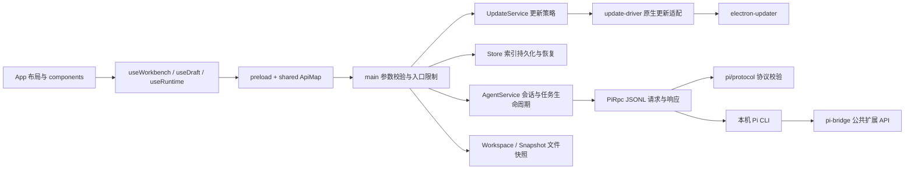

# Pi Desktop 的模块边界

桌面端负责项目、草稿、文件快照与界面；Pi 负责模型调用、工具执行和 JSONL 会话。升级 Pi 时，先检查进程协议和桌面扩展，再检查应用行为。

## 界面

- `src/App.tsx` 只组合侧栏、对话、输入框、工作区、设置及恢复提示。
- `src/hooks/useRuntime.ts` 接收 IPC 状态并应用增量更新；`useDraft.ts` 负责草稿、引用、图片与命令选择；`useShortcuts.ts` 负责键盘入口。`useWorkbench.ts` 连接各面板的操作与选中状态。
- `src/components/conversation/` 保留消息和 Markdown 的缓存边界，避免把流式更新变成整段历史的重复解析。
- `src/features/` 按 Pi 管理页签组织；纯展示函数放在 `src/lib/`。样式拆为 `src/styles/`，入口保持原有加载顺序。
- 新面板不要直接复制整个工作台状态；声明它实际需要的属性，组合子面板时使用 `children` 或明确的内容属性。

## Pi 升级

1. `shared/pi-version.ts` 是版本策略的唯一来源。`VERIFIED` 为回归使用的版本，`COMPATIBLE` 为准许连接的主、次版本线；允许同线补丁版和预发布版，不推测其他版本线兼容。
2. `electron/environment.ts` 发现入口、验证 Node 并读取 `--version`。平台路径、Shell 和终端、进程树操作集中在 `electron/platform.ts`。
3. `electron/rpc.ts` 只处理进程、JSONL、请求关联、超时和桌面扩展调用。`electron/pi/protocol.ts` 校验桌面依赖的核心响应字段并转换统计数据。允许新增字段，不猜测字段别名；字段改变时返回明确的不兼容错误。
4. `electron/pi-bridge.ts` 通过 Pi 的公开扩展 API 提供桌面所需操作。桥接命令与协议版本定义在 `shared/pi-bridge.ts`。调用前检查命令确实注册，连接时核对桥接版本，避免扩展加载失败后把内部命令发送给模型。
5. 开发依赖锁定已验证版本，以便重复测试；每周工作流单独安装最新 `@1.1`，使用真实 Pi 和本地模型接口运行集成与功能测试。通过该测试只说明覆盖到的行为兼容，不代表任意扩展都兼容。

升级支持范围时，先改协议适配和契约测试，再用真实 Pi 验证。不要为了让新版本通过而在界面或 AgentService 中添加猜测字段。

## 索引与崩溃恢复

- `electron/store-state.ts` 校验索引中的每条项目、会话及设置。`Store` 串行写入临时文件并原子替换；成功后每隔至少十分钟轮转一份备份，最多三份。
- 损坏文件先保留，再恢复可用备份；单条坏记录不会使其他记录失效。恢复时间和丢弃数量通过独立的 storage 状态传给界面。
- 存储失败后进入只读状态。启动任务前等待必要持久化完成，防止请求先发出去、保存失败才被发现。停止和查看历史、诊断仍然可用。
- Pi 意外退出时先把尚未执行的队列文字、图片恢复为草稿，再开放重连；不会自动重发原始提问。用户编辑的续写内容作为一条新消息发送。
- Pi 主进程退出不等于工具进程退出。应用自身成功结束完整进程树后可以恢复；退出时还有运行工具且无法确认清理时，后端与界面都暂停启动、切换及撤销。用户须先在系统中结束残留命令，再重新启动应用。仅刷新窗口或等待不会解除限制；仅重启应用不会结束旧命令。
- 这不是操作系统沙箱，也不负责追踪扩展主动脱离进程树的后台服务。

## 会话切换与模型错误

- `AgentService.ensureConnected()` 决定复用或重启；`installRpcHandlers()` 只安装进程监听；`rebindSession()` 为两条路径统一恢复会话状态。同目录复用，跨目录重新启动，避免项目扩展读到旧的进程工作目录。
- 桌面桥接协议第 2 版增加 `desktop_session_start` 事件，用于划分退出钩子和目标启动事件的归属。事件缺失时停止复用并重新启动；不能凭延时猜测会话已切换。
- 异步刷新同时检查进程和运行时对象，防止复用同一进程后旧结果覆盖目标会话。会话切换清空审批临时授权，断开操作与受理中的会话操作互斥。
- `shared/errors.ts` 提供纯分类和脱敏函数；Agent 仅对模型请求错误分类并计数，`ModelErrorCard.tsx` 展示描述和动作。设置、存储、进程错误不进入模型分类器。操作仍通过既有 IPC 执行。
- 诊断记录最近一次复用/重启及原因、后端耗时和最近五次模型错误的类别/时间。端到端切换耗时由真实界面测试单独记录。

## 桌面应用更新

- `shared/app-update.ts` 定义独立更新状态、安装方式、稳定版版本比较和官方 Release 地址。更新状态通过 `update` 事件推送，不混入 Pi 的消息与工具状态。
- `electron/updater.ts` 管理检查间隔、通知与自动下载模式、重试、安装前检查。它不依赖 Electron；`electron/update-driver.ts` 单独把 `electron-updater` 的事件和安装接口转换为桌面使用的接口。
- `main.ts` 提供具体安装方式、网络请求、忙碌判断和安装前保存步骤。已接收但尚未切换运行状态的 IPC 与 Agent 操作同样阻止安装，避免“刚点击发送，更新先关闭了应用”。开始准备安装后禁止新操作，先保存草稿、断开空闲 Pi 并等待写盘，再交给安装器；系统关机不触发安装。
- `Updates.tsx` 组合侧栏提示、更新说明和“关于与更新”，展示失败原因及重试入口。支持自动替换的安装方式只有 Windows NSIS 和 Linux AppImage；其余方式通过 GitHub Release 接口检查并提示手动下载。
- `Store` 记录最后写入的 `appVersion`。升级前保存原始索引并保留三份；未知的较新格式直接只读打开，不按损坏文件重命名，也不投影后写回旧格式。已知格式允许降级使用。
- `electron-updater` 由 esbuild 一起打入主进程。发布依旧只包含 `build.files` 白名单，CI 校验更新清单中的版本、文件与 SHA-512 后才上传 Release。

## 验证入口

`npm run build` 检查类型和产物；`npm test` 覆盖存储、协议、快照、审批与增量状态。`test:integration` 和 `test:features` 使用真实 Pi、本地模型服务及独立测试目录。三个 UI 套件在本地 Windows 与 CI Linux 上运行，失败截图上传为构建产物。

`node --import tsx scripts/perf-ui.mjs <标签>` 用 500 条消息、100 个工具卡片、60 次更新测量界面更新耗时并保存截图。模块拆分前后应在同一环境比较，不能用不同系统的字体渲染差异判断布局回归。
